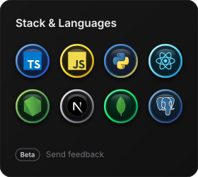
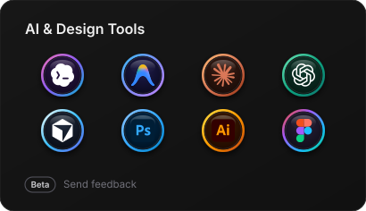
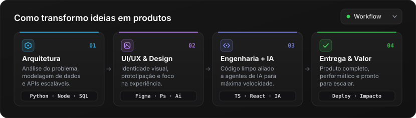

<h1>Opa, chega mais! 👋</h1>

  Graphic & Brand Designer | Prototyping & Front-end Dev | Estudante de ADS e de Gestão Pública
 

  Sou um <strong><ins>desenvolvedor criativo</ins></strong> focado em resolver problemas, da arquitetura até interfaces modernas, rápidas e escaláveis.

  Mais do que escrever código, consigo unir <strong>engenharia de software</strong>, <strong>visão de produto</strong> e <strong>design</strong> com <strong>fluxos avançados de IA</strong> para transformar desafios complexos em soluções completas e bem acabadas.

 

  
  

  

 

  
  
  

